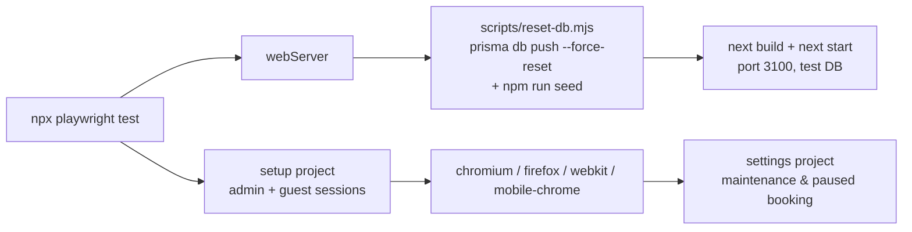
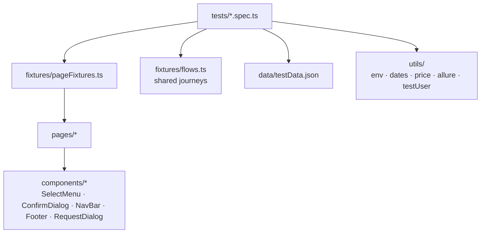
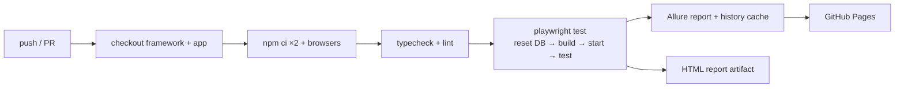

<div align="center">

# N34 Mirissa – Playwright E2E Automation Framework

End-to-end UI tests for **N34 Mirissa**, a full-stack beach hotel booking platform (Next.js 16 · Server Actions · Prisma · PostgreSQL · NextAuth).


</div>

---

## Contents

- [Highlights](#highlights)
- [How it works](#how-it-works)
- [Test coverage](#test-coverage)
- [Quick start](#quick-start)
- [Commands](#commands)
- [Project structure](#project-structure)
- [CI/CD](#cicd)
- [Writing new tests](#writing-new-tests)
- [Debugging](#debugging)

## Highlights

|                             |                                                                                                                                                                                                        |
| --------------------------- | ------------------------------------------------------------------------------------------------------------------------------------------------------------------------------------------------------ |
| **Page Object Model**       | One class per page in `pages/`, with locators as properties and no assertions inside. Shared widgets (custom dropdown, confirm dialog, nav, footer, request dialog) live in `components/`.             |
| **Typed custom fixtures**   | `test.extend<Pages>()` hands each test ready-made page objects: `async ({ roomsPage, bookingPage }) => …`.                                                                                             |
| **Real app, isolated data** | Playwright builds and starts the real app against a **separate Neon test branch**, which is wiped and re-seeded before every run. There's a guard that refuses to run against the app's real database. |
| **Log in once**             | A `setup` project signs in as admin, registers a fresh guest and saves both sessions. Each spec picks the session it needs: guest, admin or signed out.                                                |
| **Data-driven tests**       | Sort orders, guest-capacity filters, stay validation, meal-plan pricing and form errors all come from `data/testData.json`.                                                                            |
| **Parallel-safe bookings**  | Every booking uses a random far-future stay and a unique email, so parallel workers and browsers never sell out a room or clash.                                                                       |
| **Cross-browser + mobile**  | Chromium, Firefox, WebKit, plus a Pixel 7 project for `@mobile` / `@smoke` tests.                                                                                                                      |
| **Tags**                    | `@smoke`, `@admin`, `@mobile`, `@settings` let you run a subset with `--grep`.                                                                                                                         |
| **Allure 3 + HTML reports** | Each test is labelled with epic, feature, story and severity, broken into `test.step` blocks, and history is kept between runs.                                                                        |
| **CI/CD**                   | GitHub Actions checks out both repos, type-checks, lints, runs everything and publishes the Allure report to GitHub Pages.                                                                             |

## How it works

The app renders pages and handles forms on the server (Server Components and Server Actions), so there's no REST API to mock. The tests drive the real app on a real test database:





**Things worth knowing about the app:**

- **Locators.** There are no `data-testid` attributes, so tests use ids, labels, roles and the app's own `data-*` hooks.
- **Custom dropdowns.** These are `role="combobox"` widgets rather than `<select>` elements, so `components/SelectMenu.ts` wraps them.
- **Email verification.** Tokens are stored hashed and the link only ever goes to the server console. The test server therefore runs with `REQUIRE_EMAIL_VERIFICATION=false`.
- **Settings tests.** Maintenance mode and paused booking affect every page. They run in their own `settings` project after the main run, and always switch both back off.

## Test coverage

About 50 test cases (data-driven tests expand into one test per scenario).

| ID       | Scenario                                                                  | Feature        | Tags      |
| -------- | ------------------------------------------------------------------------- | -------------- | --------- |
| TC01     | Each nav link opens its page and is marked current                        | Navigation     |           |
| TC02     | Dark mode toggle is applied and remembered after reload                   | Navigation     | @mobile   |
| TC03     | Footer links point to the right pages                                     | Navigation     |           |
| TC04     | Unknown address shows "Page not found" (404)                              | Navigation     | @mobile   |
| TC05     | Mobile menu opens and navigates                                           | Navigation     | @mobile   |
| TC06     | Home availability search goes to matching rooms with the query            | Home           | @smoke    |
| TC07     | FAQ answers open and close                                                | Home           |           |
| TC08     | Featured room card opens the room page                                    | Home           | @mobile   |
| TC09     | All rooms listed, cheapest first                                          | Rooms          |           |
| TC10     | Sorting (3 scenarios)                                                     | Rooms          |           |
| TC11     | Guest-capacity filter (3 scenarios)                                       | Rooms          |           |
| TC12     | Facility filter                                                           | Rooms          |           |
| TC13     | Empty state when nothing fits                                             | Rooms          |           |
| TC14     | Dates show rooms left                                                     | Rooms          | @mobile   |
| TC15     | Check-out before check-in error                                           | Rooms          |           |
| TC16     | Unknown room id gives "Page not found"                                    | Rooms          |           |
| **TC17** | **Guest books → confirmation → find booking → cancel**                    | Booking        | @smoke    |
| TC18     | Invalid stays block booking (3 scenarios)                                 | Booking        |           |
| TC19     | Missing dates block booking                                               | Booking        |           |
| TC20     | Total price per meal plan (4 scenarios)                                   | Booking        |           |
| TC21     | Guest-detail validation (3 scenarios)                                     | Booking        |           |
| TC22     | `/book` without a room goes back to Rooms                                 | Booking        |           |
| TC23     | Find my booking rejects a wrong email                                     | Booking        |           |
| TC24     | Register and sign in                                                      | Authentication | @smoke    |
| TC25     | Registration validation (4 scenarios)                                     | Authentication |           |
| TC26     | Duplicate email is refused                                                | Authentication |           |
| TC27     | Sign-in errors (3 scenarios)                                              | Authentication |           |
| TC28     | Staff account refused on the guest sign-in page                           | Authentication |           |
| TC29     | `/user` needs sign-in and returns there after                             | Authentication |           |
| TC30     | Sign out                                                                  | Authentication |           |
| TC31     | Signed-in booking shows in My bookings and can be cancelled               | My account     |           |
| TC32     | Booking form pre-filled for a signed-in guest                             | My account     |           |
| TC33     | Profile name and phone update persists                                    | My account     |           |
| TC34     | Password change needs the right current password                          | My account     |           |
| TC35     | Contact message sent                                                      | Contact        | @smoke    |
| TC36     | Contact validation (3 scenarios)                                          | Contact        |           |
| TC37     | Map and directions link                                                   | Contact        | @mobile   |
| TC38     | Special dinner request                                                    | Dining         |           |
| TC39     | Experience request                                                        | Experiences    |           |
| TC40     | Past date blocked in a request                                            | Experiences    |           |
| TC41     | Category chips filter experiences                                         | Experiences    | @mobile   |
| TC42     | Admin sign-in                                                             | Admin          | @admin    |
| TC43     | Guest refused on admin sign-in                                            | Admin          | @admin    |
| TC44     | `/admin` redirects visitors to staff sign-in                              | Admin          | @admin    |
| **TC45** | **Visitor books → admin finds it → assigns room (confirms) → marks paid** | Admin          | @admin    |
| TC46     | Booking search with no match                                              | Admin          | @admin    |
| TC47     | Booking record tabs                                                       | Admin          | @admin    |
| TC48     | Admin sidebar navigation                                                  | Admin          | @admin    |
| TC49     | Pause online booking hides the booking bar for visitors                   | Site settings  | @settings |
| TC50     | Maintenance mode hides the site from visitors, not staff                  | Site settings  | @settings |

## Quick start

**Requirements:**

- Node.js 22.18 or newer (the Allure 3 CLI needs it)
- The N34 Mirissa app checked out next to this folder, with `npm install` already run in it
- A Neon **test branch**

1. **Create the test database.** In the Neon console, open the N34 Mirissa project and choose **Branches → New branch** (e.g. `test`). Copy its connection string.
2. **Install:**
   ```bash
   npm install
   npx playwright install
   ```
3. **Configure:** copy `.env.example` to `.env` and fill in:
   - `TEST_DATABASE_URL`: the test branch connection string. It must **not** be the app's `DATABASE_URL`.
   - `AUTH_SECRET`: any long random string.
   - `APP_DIR`: only change this if the app isn't at `../N34 Mirissa`.
4. **Run:**
   ```bash
   npm run test:chromium
   ```
   The first run resets and seeds the test database, builds the app and starts it on port 3100, which takes a few minutes. Later local runs reuse a server that's still running on 3100.

> If you start the app on 3100 yourself instead, start it with the test database and `REQUIRE_EMAIL_VERIFICATION=false`, and run `npm run db:reset` first.

## Commands

| Command                                                  | What it does                                                |
| -------------------------------------------------------- | ----------------------------------------------------------- |
| `npm test`                                               | Everything: all browsers, mobile, then the settings project |
| `npm run test:chromium` / `test:firefox` / `test:webkit` | One browser                                                 |
| `npm run test:mobile`                                    | Pixel 7: `@mobile` and `@smoke` tests                       |
| `npm run test:smoke`                                     | `@smoke` tests on Chromium                                  |
| `npm run test:admin`                                     | `@admin` tests on Chromium                                  |
| `npm run test:settings`                                  | Maintenance and paused-booking tests (runs Chromium first)  |
| `npm run test:headed` / `test:ui` / `test:debug`         | Watch, explore or step through tests                        |
| `npm run report`                                         | Open the Playwright HTML report                             |
| `npm run test:allure` then `npm run allure:open`         | Run with Allure and open the report                         |
| `npm run db:reset`                                       | Wipe and re-seed the test database now                      |
| `npm run typecheck` / `npm run lint` / `npm run format`  | Code quality                                                |

## Project structure

```
├── .github/workflows/playwright.yml   CI: both repos → typecheck/lint → tests → Allure on GitHub Pages
├── components/                        Reusable widgets used by several pages
│   ├── SelectMenu.ts                  The app's custom combobox dropdown
│   ├── ConfirmDialog.ts               Native <dialog> confirmations (cancel booking, mark paid…)
│   ├── RequestDialog.ts               "Request" window on dining and experiences
│   ├── NavBar.ts · Footer.ts
├── data/testData.json                 Scenarios and expected values for data-driven tests
├── fixtures/
│   ├── pageFixtures.ts                test.extend with every page object
│   └── flows.ts                       Shared journeys: createGuestBooking, registerAndSignIn
├── pages/                             Page objects (BasePage + one per page, admin/ for staff screens)
├── scripts/reset-db.mjs               Wipes and seeds the TEST database (with safety checks)
├── tests/
│   ├── auth.setup.ts                  Saves admin + guest sessions
│   └── *.spec.ts                      navigation, home, rooms, booking, auth, account,
│                                      contact, requests, admin, maintenance
├── utils/                             env (validated .env), dates, price, allure labels, test users
├── playwright.config.ts               Projects, webServer, reporters
└── allurerc.mjs                       Allure 3 report settings
```

## CI/CD



<details>
<summary><b>One-time setup for the repository</b></summary>

1. **Settings → Secrets and variables → Actions.** Add:
   - `TEST_DATABASE_URL`
   - `AUTH_SECRET`
   - `ADMIN_PASSWORD` (optional, default `admin`)
   - `APP_REPO_TOKEN`: only needed if the N34 Mirissa repo is private. Use a token with read access to it.
2. **Settings → Pages:** set the source to **GitHub Actions**.

</details>

## Writing new tests

1. Add locators and actions to the page object, or create a new one in `pages/` and register it in `fixtures/pageFixtures.ts`.
2. Put scenarios in `data/testData.json` and loop over them in the spec.
3. Start each test with `labelTest({ feature, story, severity })` and wrap actions in `test.step(...)`.
4. If a test creates bookings, use `randomFutureStay()` and `uniqueEmail()` so it can run in parallel.
5. Choose the session with `test.use({ storageState: SIGNED_OUT | ADMIN_AUTH_FILE })`. The guest session is the default.

## Debugging

- Screenshots, videos and traces are kept for failed tests in `test-results/`.
- Open a trace with `npx playwright show-trace test-results/<test>/trace.zip`.
- Step through a test with `npm run test:debug -- tests/booking.spec.ts`.
- If the app won't start, run its build in the app folder to see the error: `npm run build`. The webServer only shows stderr.

## License

MIT
